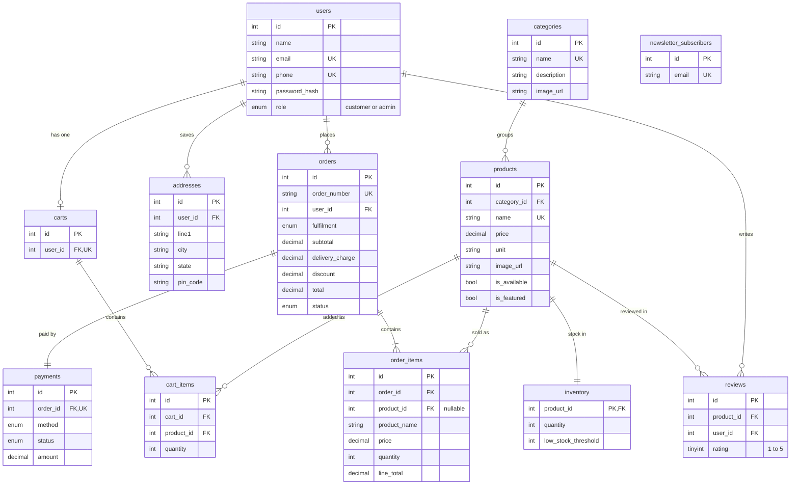

# Database design: arunai_sacred_soils

12 tables, InnoDB, utf8mb4. The diagram below renders in GitHub, VS Code (Markdown Preview Mermaid Support extension) and mermaid.live.

## Design decisions

* **Stock is in `inventory`, not `products`.** One row per product keeps the catalogue table clean and lets checkout lock only the stock rows.
* **`order_items` copies the product name, unit, image and price** at purchase time. Editing or deleting a product later never changes old orders (`product_id` becomes NULL on delete).
* **Money is `DECIMAL(10,2)`**, never floating point. A `CHECK` keeps prices above zero.
* **Cascades:** deleting a user removes their cart, cart items and addresses. Deleting a product removes its inventory row and cart entries. Orders are protected: a user with orders cannot be deleted, and a category with products cannot be deleted.
* **Unique constraints** stop duplicate emails, phone numbers, order numbers, product names, category names, one cart per user, one product line per cart, and one payment per order.
* **Passwords** are stored only as bcrypt hashes in `password_hash`. Card and UPI details are never stored (payments are demo only).
* **Indexes** cover every foreign key plus the columns the app filters and sorts on (`products.price`, `products.is_featured`, `orders.status`, `orders.created_at`).
* **No customers or admin rows are inserted by the schema.** Create the admin with `npm run seed:admin`.
